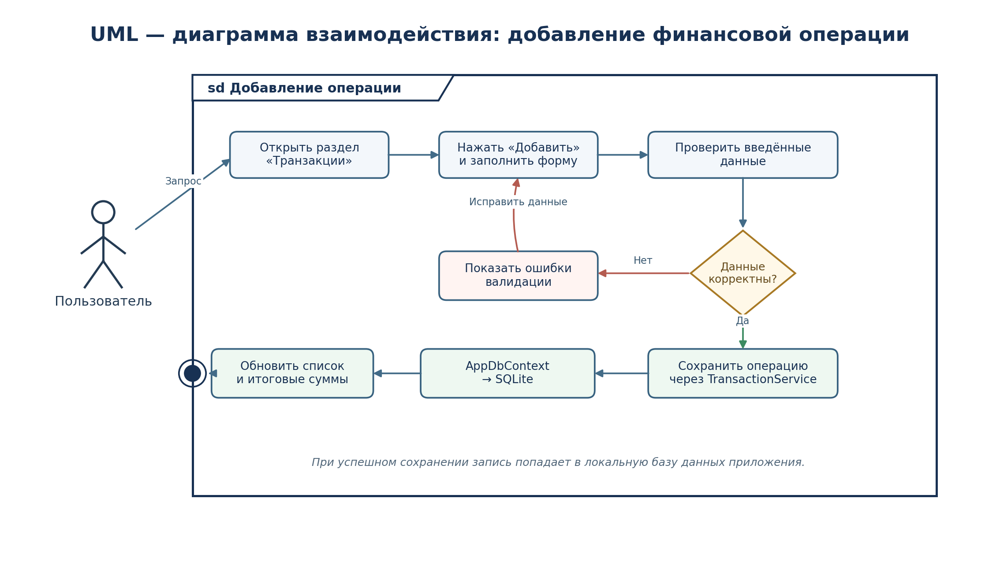

# FinTrack

**FinTrack** — настольное приложение для учёта личных доходов и расходов. Оно помогает вести список операций, видеть общий баланс, анализировать траты по категориям и следить за динамикой финансов по месяцам.

Приложение работает локально: финансовые данные хранятся в базе SQLite на компьютере пользователя и не синхронизируются с внешними сервисами.

## Возможности

### Обзор (Dashboard)

- Карточки «Общий баланс», «Доходы за месяц», «Расходы за месяц» и «Баланс месяца».
- Переключение отображаемого месяца; переход в будущие месяцы запрещён.
- Столбчатая диаграмма доходов и расходов за последние шесть месяцев.
- Круговая диаграмма расходов по категориям за выбранный месяц с легендой, в которой указаны суммы и доли. Показываются до шести крупнейших категорий; остальные объединяются в «Другое».
- Список пяти последних операций за всё время.
- Пустые состояния, если за выбранный месяц нет расходов или в базе ещё нет операций.

### Транзакции

- Список операций с типом, категорией, датой, описанием и суммой.
- Добавление дохода или расхода.
- Редактирование существующей операции и отмена редактирования.
- Удаление с панелью подтверждения и возможностью отмены.
- Поиск по описанию и названию категории; список обновляется по мере ввода.
- Фильтрация по типу операции, категории и диапазону дат.
- Сортировка по дате, сумме и категории в обоих направлениях.
- Сброс всех фильтров и сортировки.
- Итоговые карточки «Баланс», «Доходы» и «Расходы» показывают суммы за всё время. Поиск и фильтры влияют только на отображаемый список, но не на итоги.
- Пустые состояния «Ничего не найдено» (если активны поиск или фильтры) и «Пока нет транзакций» (если база пуста).

### Валидация

- Сумма должна быть больше нуля и не превышать `9 999 999 999 999 999,99`.
- Сумма может содержать не более двух знаков после запятой; в качестве разделителя поддерживаются запятая и точка.
- Описание необязательно и ограничено 200 символами.
- Проверяются тип операции, категория и дата.
- Категория должна соответствовать типу операции: доход нельзя сохранить с расходной категорией, и наоборот.
- Неверный диапазон дат фильтра не применяется; пользователь видит сообщение «Дата начала не может быть позже даты окончания.».

### Интерфейс

- Два экрана — «Обзор» и «Транзакции» — с навигацией в боковом меню.
- Принудительная тёмная тема и единая палитра оформления.
- Русскоязычный интерфейс; валюта — российский рубль (₽).

## Технологии

| Компонент | Версия |
|---|---|
| .NET | 10 (`net10.0`) |
| Язык | C# |
| UI-фреймворк | Avalonia 12.1.4 (Desktop, Fluent, Inter) |
| MVVM | CommunityToolkit.Mvvm 8.4.2 |
| Графики | ScottPlot.Avalonia 5.1.59 |
| База данных | SQLite через Microsoft.EntityFrameworkCore.Sqlite 10.0.14 |
| Тесты | xUnit 2.9.3, Microsoft.NET.Test.Sdk 18.11.1 |

## Архитектура

Приложение построено по паттерну **MVVM**.

- `Views` — разметка Avalonia и настройка графиков ScottPlot.
- `ViewModels` — состояние экранов, команды, поиск, фильтры и сортировка.
- `Services` — `TransactionService` (CRUD и правила валидации) и `StatisticsService` (агрегаты для Dashboard).
- `Data` — `AppDbContext` и `DatabaseInitializer`.
- `Models` — `Transaction`, `Category`, `Budget` и модели Dashboard.
- `Converters` — преобразование типов операций и цветов категорий для интерфейса.

`ViewLocator` сопоставляет ViewModel и View по имени типа. Зависимости собираются вручную в `App.axaml.cs`, без DI-контейнера. Интерфейс `ITransactionService` позволяет подменять хранилище в тестах и использовать отдельную временную базу SQLite.

### Структура репозитория

```text
FinTrack/
├── .gitignore
├── FinTrack.slnx
├── README.md
├── PROJECT_STATUS.md
├── FinTrack/                  # приложение
│   ├── Assets/
│   ├── Converters/
│   ├── Data/
│   ├── Models/
│   ├── Services/
│   ├── ViewModels/
│   ├── Views/
│   ├── App.axaml
│   ├── Program.cs
│   └── ViewLocator.cs
├── FinTrack.Tests/            # автоматические тесты (xUnit)
└── docs/
    └── diagrams/
        └── Диаграмма.png      # UML-диаграмма
```

## Требования

- **Windows 10/11 x64** — целевая платформа; разработка и проверка выполнялись на Windows 11 x64.
- **.NET SDK 10.0** — для сборки и запуска из исходников.
- Для опубликованной self-contained сборки отдельная установка .NET Runtime не требуется.

Другие операционные системы не тестировались.

## Запуск

Из корня репозитория:

```powershell
dotnet restore
dotnet run --project FinTrack/FinTrack.csproj
```

### Сборка

```powershell
dotnet build FinTrack.slnx
```

### Тесты

```powershell
dotnet test FinTrack.slnx
```

В проекте 109 автоматических тестов (xUnit), покрывающих сервисы транзакций и статистики, ViewModel экранов, поиск, фильтры, сортировку, редактирование и удаление, а также интеграционные сценарии на временной базе SQLite.

### Публикация для Windows

```powershell
dotnet publish .\FinTrack\FinTrack.csproj -c Release -r win-x64 `
  --self-contained true `
  -p:PublishTrimmed=false `
  -p:DebugType=None `
  -o .\publish\win-x64
```

После публикации приложение запускается файлом `publish\win-x64\FinTrack.exe`. Папка `publish/` исключена из Git.

Обрезка (trimming) отключена, поскольку `ViewLocator` использует рефлексию (`Type.GetType`). Публикация выполняется в папочном режиме, без single-file: так проще диагностировать проблемы с нативными библиотеками SQLite и SkiaSharp.

## Данные

- База данных создаётся при первом запуске: `%LocalAppData%\FinTrack\fintrack.db`.
- Схема создаётся через `Database.EnsureCreated()`.
- При первом запуске добавляются шесть категорий: «Продукты», «Транспорт», «Развлечения», «Здоровье» (расходы), «Зарплата», «Подработка» (доходы).
- Приложение не содержит функций синхронизации, авторизации, импорта или экспорта данных.
- Файлы баз данных исключены из Git через `.gitignore`.

Чтобы начать с пустой базы, закройте приложение и удалите файл `%LocalAppData%\FinTrack\fintrack.db`. **Это приведёт к потере всех сохранённых операций.**

## Ограничения и известные замечания

- Модель `Budget` и `DbSet<Budget>` присутствуют, но интерфейс и сервисы бюджетов не реализованы.
- Используется `EnsureCreated()` вместо миграций EF Core: при изменении схемы потребуется ручное вмешательство или пересоздание базы.
- Нет UI-автотестов и сквозных тестов приложения.
- Нет экспорта, импорта и резервного копирования из интерфейса.
- Интерфейс только русскоязычный; валюта фиксирована — рубль (₽).
- Нет отдельного журналирования ошибок: сообщения показываются в интерфейсе.
- При минимальной ширине окна текст сортировки может обрезаться, а подписи оси X на графике — соприкасаться.
- Поле «Категория» в форме пустое до выбора и не показывает подсказку.
- Прокрутка колесом мыши над выбором даты может изменить дату.

## UML-диаграмма

Ниже приведена UML-диаграмма взаимодействия для сценария добавления финансовой операции.



## Лицензия

Файл `LICENSE` в репозитории отсутствует; условия использования проекта пока не определены.
